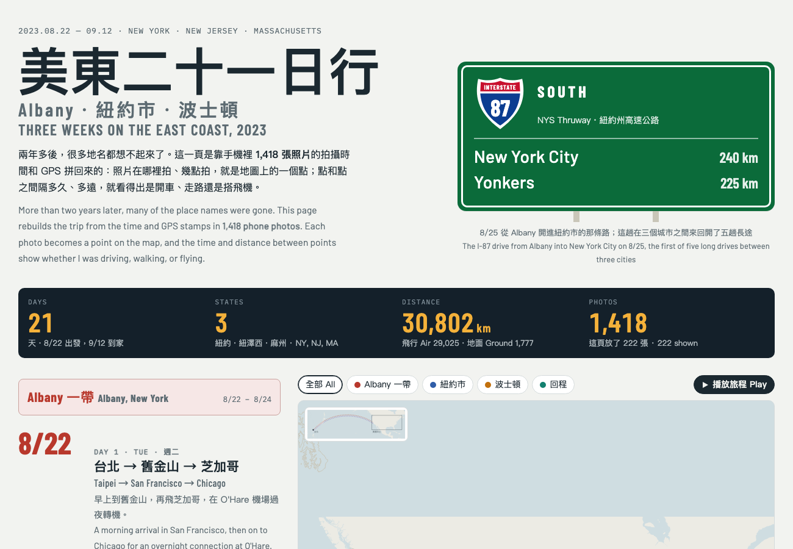

# Photo Trip Map: Three Weeks on the US East Coast (2023)

**照片旅程地圖：美東二十一日行（2023-08-22 ～ 09-12）**

Albany, New York City, and Boston, rebuilt from the time and GPS stamps in phone photos. One color per region, a day-by-day log that moves the map as you scroll, and a "Play" button that replays the whole trip.

Live page: https://lukelin7429.github.io/us-trip-2023-map/ (sister page for 2025: https://lukelin7429.github.io/us-trip-map/)



## How it is built

| Step | Script | What it does |
|---|---|---|
| 1 | `osxphotos` | Export photo metadata (time, time zone, GPS, faces) from Apple Photos to `photos.json` (not committed) |
| 2 | `make_thumbs.py`, `sheet.py` | Contact sheets of candidate photos (no faces, or the author alone) for choosing |
| 3 | `fetch_osm.py`, `fetch_local.py` | OpenStreetMap coastline, water, highways, and streets around public stops (only bounding boxes and stop coordinates are sent) |
| 4 | `routes.py` | Driving geometry between neighboring public stops from the OSRM demo server |
| 5 | `build_geo.py` | Project everything (Albers equal-area conic, `proj.py`) into `geo.json` |
| 6 | `build_data.py` | Days, stops, legs, captions; resize chosen photos without EXIF into `docs/img/`; write `docs/data.json` |
| 7 | `make_pages.py` | Wrap `page.html` into `docs/index.html` |

```bash
uvx osxphotos query --to-date 2025-08-31 --json > photos.json
uv run --with pillow --with pillow-heif python make_thumbs.py
python3 fetch_osm.py albany boston && python3 fetch_tiles.py && python3 fetch_local.py && python3 routes.py
uv run --with shapely python build_geo.py
uv run --with pillow --with pillow-heif --with shapely python build_data.py
python3 make_pages.py
```

After changing `data.json` or `geo.json`, bump the `?v=` numbers in `page.html` so browsers fetch the new files.

## Privacy

- Photo metadata and raw stop coordinates stay out of the repository (`.gitignore`).
- Published photos are re-encoded JPEGs with no EXIF or GPS data.
- Only photos with no faces, or with the author alone, are published.
- Places I stayed are named by town only and drawn at the town center; friends' homes are not shown at all.

## Credits

Map data © OpenStreetMap contributors (ODbL). Routing: OSRM. Base map: Natural Earth and US Census boundaries via us-atlas. Fonts: Barlow, Barlow Condensed, IBM Plex Mono (Google Fonts); Chinese text uses system fonts.

Made by Luke Lin (林吉祥).

Notes: the stops and captions live in `content.py` and are spliced into `build_data.py`. A few New York State Museum photos were saved with a Taipei time stamp; `TIME_FIX` shifts them back 12 hours. Subway and bus rides in New York are drawn as straight dashed lines because their real routes are not in the photos.
